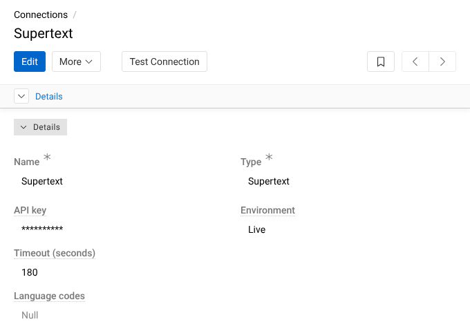
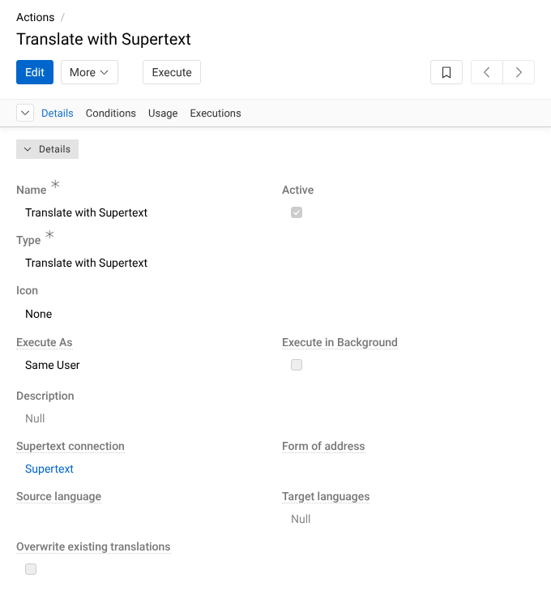
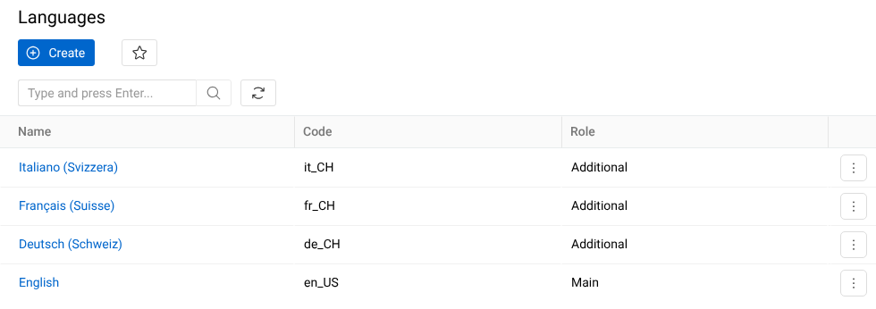

# Installation guide — Supertext Translation for AtroPIM

For administrators. The module adds **Translate with Supertext** to AtroPIM (and any other AtroCore application): a button on products and other records, and a mass action in their lists, that translates the record's multilingual text fields into your other languages with Supertext AI.

## Requirements

- AtroCore 2.4 or later with AtroPIM 1.16 or later (tested with AtroCore 2.4.7 and AtroPIM 1.16.10), on PHP 8.4 or 8.5 with the `curl`, `dom` and `mbstring` extensions (AtroCore needs them anyway).
- At least two languages under **Administration → Languages**, and multilingual fields (see [Languages](#languages)).
- AtroCore's cron job (`php console.php cron` every minute, part of every AtroCore installation) for translations that run in the background.
- A Supertext account with an AI API key. No Supertext account yet? Create one at supertext.com: <https://www.supertext.com/person/en/account/signin>. Generate your API key at supertext.com → Integrations → API: <https://www.supertext.com/en/integrations/api> (requires the Admin role).
- The server must reach `https://api.supertext.com` over HTTPS (and, unless you turn version reports off, the Supertext Commando Center: see [Version information and the API key check](#version-information-and-the-api-key-check)).

## Install

The module is installed with AtroCore's installer (`atrocore-installer.phar`, the Composer wrapper in your AtroCore directory), like AtroCore's own modules.

1. Add this repository to the `repositories` list of your AtroCore project's `composer.json` (the module is not on a package registry yet):

   ```json
   "repositories": [
     {"type": "vcs", "url": "https://github.com/Supertext/AtroPIM-Supertext-Translation"}
   ]
   ```

   Keep the entries that are already there (AtroCore's own registry).

2. In the AtroCore directory, install it:

   ```bash
   php atrocore-installer.phar require supertext/atropim-supertext-translation:dev-main
   ```

   The installer runs AtroCore's update afterwards: it registers the module, adds the database columns of the action options, clears the cache and copies the front-end files. Once versions are released (see the [releases](https://github.com/Supertext/AtroPIM-Supertext-Translation/releases)), require a version such as `:^0.1` instead of `:dev-main`.

3. Reload AtroPIM in the browser. **Administration → Updates & Modules** lists *Supertext Translation* with its version.

4. Create the Supertext connection ([API key](#api-key)) and the action ([The action](#the-action)).

### Update

```bash
php atrocore-installer.phar update
```

Then reload AtroPIM. Settings, the connection and the actions are kept.

### Uninstall

1. Delete the actions of type *Translate with Supertext* (**Administration → Actions**) and the connections of type *Supertext* (**Administration → Connections**).
2. `php atrocore-installer.phar remove supertext/atropim-supertext-translation`
The columns the module added to the `action` table (`supertext_…`) stay in the database unused.

Translations that were already made stay in your records: they are ordinary field values.

## API key

The key is stored in a **connection** of type *Supertext*, encrypted like every password in AtroCore.

1. Open **Administration → Connections** and click **Create**.
2. Enter a name (e.g. *Supertext*), choose the type **Supertext** and paste the key into **API key**. You can paste it with or without the `Supertext-Auth-Key` prefix Supertext shows it with.
3. Save. Saving checks the key with Supertext (free of charge); the read-only field **API key check** shows the result and when it ran. **Test connection** runs the same check again.



The check's messages: *API key checked: the connection to Supertext works.*; *Supertext rejected the API key …* and *No API key is set yet …* (both with the links to create an account and generate a key); *… because Supertext can't be reached* or *Supertext answered with an error (HTTP …)*: the settings are saved, check again later. An invalid key never blocks saving.

The field's tooltip has both links: no Supertext account yet? Create one at <https://www.supertext.com/person/en/account/signin>. Generate your API key at <https://www.supertext.com/en/integrations/api> (supertext.com → Integrations → API; requires the Admin role).

Instead of entering the key in AtroPIM you can set it on the server as the environment variable `SUPERTEXT_API_KEY`; it is used when the connection has no key (or when there is no Supertext connection at all). The connection's key takes precedence.

## The action

Translating is an AtroCore **action** of the new type *Translate with Supertext*. Create one per kind of record that should be translatable (usually one for *Product*):

1. **Administration → Actions → Create**.
2. **Name**: what editors see on the button, e.g. *Translate with Supertext*. **Type**: *Translate with Supertext*.
3. **Usage**: *Record*; **Source entity**: *Product* (or *Category*, *Brand*, …); **Display**: *Single* shows a button next to *Edit*, *Dropdown* puts it in the *More* menu. Leave **Mass action** on to offer it in the list's *Actions* menu.
4. **Execute as**: *Same user* (recommended) saves the translation with the editor's permissions and in the editor's name; *System* lets anyone who sees the button translate.
5. The Supertext options (see [Settings](#settings)): connection, source and target languages, overwrite, form of address.
6. Optional: **Execute in background** runs the translation as a job; the editor gets a notification when it is done.



Several actions are fine, e.g. *Translate into French* with only `fr_FR` as target, or one that overwrites existing translations for a chief editor. AtroCore's **Conditions** panel limits the records the action runs on, for example only products in status *Draft*.

### Export for translation and Import translation

For translations made outside the API (a translation tool such as Trados, memoQ or Phrase, a translator, Supertext's web app), two more action types export a record's texts as a file and import the translated file again. Nothing to configure besides the actions:

1. **Export for translation**: **Type** *Export for translation*, **Usage** *Record*, **Source entity** *Product* (or another entity), **Display** as you like, **Mass action** off. Options: the Supertext connection (only for its language mapping: the codes written into the file), source and target languages, **File format** (*XLIFF 1.2 (for translation tools)*: all target languages in one file; *HTML (one language per file)*: exactly one target language), **Overwrite existing translations** (off: only the fields still empty in a target language go into the file, as for *Translate with Supertext*). Clicking the button downloads `atropim-product-<id>-<language>.xlf` (or `.html`; `atropim-product-<id>.xlf` for several languages).
2. **Import translation**: **Type** *Import translation*, **Usage** *Record* (button on the record) or *Entity* (button in the list). It has no options: the button opens the upload page (`/api/supertext/import`) in a new tab; the file itself says which records and languages it belongs to.

Don't tick **Execute in background** for these two. Both open a new browser tab: if the browser blocks pop-ups for AtroPIM, allow them. The upload page and the download use the editor's AtroCore session.

- **Upload size:** at most 10 MB per file. PHP's `upload_max_filesize` and `post_max_size` must allow that (their defaults, 2 MB and 8 MB, are lower: raise them to `10M`/`12M` if editors import large files). The file is read in memory and never stored.
- An unmapped language doesn't block the export: it is written into the file with its AtroCore code (`xx_YY` → `xx-YY`).
- The same as console commands: `supertext export` and `supertext import` (see [Console commands](#console-commands)), and as REST API: `GET /api/supertext/export?entity=Product&id=<id>&targets=de_CH&format=xliff`, `POST /api/supertext/import` (multipart field `file`, optional `includeChanged=1`, `overwrite=1`; `Accept: application/json` for a JSON summary).

## Languages

AtroCore translates between its **languages** (**Administration → Languages**): the main language plus additional ones.



- A field is translated only if it is **multilingual**: under **Administration → Entities → Product → Fields**, open the field and tick *Multilingual*. AtroPIM's name, short description and long description are multilingual by default. For attributes, tick *Multilingual* on the attribute.
- The source language is the main language unless the action sets another one.

### Supertext language codes and the language mapping

Supertext accepts only its own language codes, and the module doesn't guess: whether a site's `de_DE` should be written for Germany or Switzerland is your decision. Each AtroCore language is sent as

1. the code in the connection's **Language mapping**, one line per language: `de_DE = de-CH`, `es_ES = es`, `zh_CN = zh-Hans`; else
2. the Supertext code it equals apart from upper/lower case and `_`/`-`: `de_CH` → `de-CH`, `fr_FR` → `fr-FR`, `it_IT` → `it-IT`, `en_US` → `en-US`, `nl` → `nl`; else
3. its obvious default as a target (since Supertext SDK 0.4.0): a bare `de`, `en`, `fr`, `it`, `pt` → `de-DE`, `en-US`, `fr-FR`, `it-IT`, `pt-PT`; `zh_CN` → `zh-Hans`, `zh_TW` → `zh-Hant`; a region of a language Supertext offers without one → the bare code (`es_ES` → `es`, `nl_NL` → `nl`, `sl_SI` → `sl`); else
4. nothing: the language is **not mapped** (e.g. `de_LI`, `en_IE`, `fr_BE`, `sr_RS`), and translating into (or from) it fails with *The language … has no Supertext language yet* without sending anything.

The source language uses the same line without its region (`de_DE = de-CH` sends the source `de`; `en_US` is sent as `en`).

Supertext's target codes (October 2026; the API's list is `GET features`):

| Kind | Codes |
| --- | --- |
| With a region | German `de-AT`, `de-CH`, `de-DE`; English `en-GB`, `en-US`; French `fr-CH`, `fr-FR`; Italian `it-CH`, `it-IT`; Portuguese `pt-BR`, `pt-PT` |
| With a script | Chinese `zh-Hans`, `zh-Hant`; Serbian `sr-Cyrl`, `sr-Latn` |
| Swiss German dialects | `gsw-u-sd-chzh` (Zurich), `gsw-u-sd-chbe` (Bern) |
| Without a region | `bg`, `cs`, `da`, `el`, `es`, `fi`, `hr`, `hu`, `ja`, `ko`, `nb`, `nl`, `pl`, `rm`, `ru`, `sk`, `sl`, `sq`, `sv`, `tr` |

So AtroCore's `es_ES`, `nl_NL` or `zh_CN` work without a line, and a bare `de` is translated as German for Germany (`de-DE`); add a line where you want something else (`de = de-CH`) and for languages without a default (`fr_BE = fr-FR`). A mapped code that isn't in the list is sent as entered, so a language Supertext adds later works right away.

The connection's read-only field **Languages** shows every AtroCore language with the code it is sent as, *not mapped* for the ones that still need a line, and *(no formal/informal tone)* for targets where Supertext offers no form of address (English, Romansh, Albanian, Swiss German, Serbian): the action's *Formal*/*Informal* is not sent for those, and the result says so (*Supertext offers no formal or informal tone for en_US: translated with the default tone.*).

## Which fields are translated

Multilingual text fields (*varchar*, *text*, *markdown* and *wysiwyg*) of the record, attribute values included. Rich text keeps its formatting (bold text, links, lists). Everything else (numbers, lists of options, files, relations, …) stays as it is. Fields that are read-only are skipped. The [user guide](USER_GUIDE.md#what-is-translated) has the details.

## Interface languages

The module's labels, tooltips and options (the action type, the action and connection fields) the upload page of *Import translation* and its messages (action results, import summaries, errors, *Test connection*) are available in English, German, French and Italian. They follow each user's AtroCore interface language: the language of the *Locale* in the user's profile, or the system's default locale. Other languages show the English texts. The console commands (`supertext check`, `translate`, `export`, `import`) answer in English; an execution's log keeps the language of the user who ran it.

## Permissions

| What | Who |
| --- | --- |
| See and run the action | Everyone who may read the entity (**Administration → Roles**: *Read* on the entity; the demo's editor role also has *Read* on *Actions*). |
| Save the translation | With *Execute as: Same user*: whoever may edit the record (*Edit*; for attribute values also *Create attribute value*). With *Execute as: System*: anyone who may run the action. |
| Export for translation | Whoever may read the record (the download runs as the signed-in user, whatever *Execute as* says). |
| Import translation | Whoever may edit each record in the file (*Edit*, as the signed-in user); records the user may not edit are reported and left alone. |
| Connections and actions | Administrators. |

Use **Conditions** on the action, or roles, to show the button only to the right people.

## Settings

Connection (**Administration → Connections**, type *Supertext*):

| Setting | Default | |
| --- | --- | --- |
| API key | none | Encrypted. Falls back to the environment variable `SUPERTEXT_API_KEY`. |
| Environment | Live | *Live* (`https://api.supertext.com/v1/`), *Staging*, *Testing* or *Custom URL*. The environment variable `SUPERTEXT_API_URL` overrides it (for tests against a stand-in API). |
| API URL | none | Only for *Custom URL*. |
| Timeout (seconds) | 180 | How long to wait for one language (30 to 1800). |
| Language mapping | none | One line per AtroCore language and its Supertext code: `de_DE = de-CH`, `es_ES = es`. Needed for every language that isn't already a Supertext code (see [Supertext language codes](#supertext-language-codes-and-the-language-mapping)). Stored as before under the field name `supertextLanguageCodes` (formerly *Language codes*). |
| Send version information to Supertext | on | Sends the site URL and the versions of this module, the PIM and the runtime to Supertext when you save these settings and after an update, so Supertext support can see which version you run. No content, no API key and no personal data are sent. The environment variable `SUPERTEXT_VERSION_REPORTS=0` turns it off for the whole installation (see [below](#version-information-and-the-api-key-check)). |
| API key check | (read-only) | The latest automatic check of the key, with its time, and whether version information is sent (with the ping URL). |
| Languages | (read-only) | Each AtroCore language with its Supertext code, or *not mapped*. |

Action (**Administration → Actions**, type *Translate with Supertext*):

| Setting | Default | |
| --- | --- | --- |
| Supertext connection | the first connection of type Supertext | Which key and settings to use. |
| Source language | the main language | The language to translate from. |
| Target languages | every other language | The languages to translate into. |
| Overwrite existing translations | off | Off: fields that already have text in a target language are kept. On: they are replaced. |
| Form of address | Default | *Formal* or *Informal*, for languages that have both (German *Sie*/*du*, French *vous*/*tu*, …). Not sent for targets where Supertext doesn't offer it (see the connection's **Languages**). |
| File format | XLIFF 1.2 | Only *Export for translation*: *XLIFF 1.2 (for translation tools)*, one file for all target languages, or *HTML (one language per file)*. The connection, languages and *Overwrite existing translations* apply to this type too. |

AtroCore's own action settings apply as usual: *Execute as*, *Execute in background*, *Mass action*, *Display*, *Conditions*.

The installed version is shown under **Administration → Updates & Modules** and by `php console.php "supertext check"`, which links X.Y.Z versions to their GitHub release.

Environment variables (on the server; for Apache and PHP-FPM wherever your setup passes them to PHP):

| Variable | |
| --- | --- |
| `SUPERTEXT_API_KEY` | The key, when the connection has none. |
| `SUPERTEXT_API_URL` | Overrides the API URL (tests against a stand-in API). |
| `SUPERTEXT_VERSION_REPORTS` | `0` (or `false`, `off`, `no`) turns version reports off for the whole installation, whatever the connection says; `1` turns them on. |
| `SUPERTEXT_REPORT_URL` | Only for tests: where reports go instead of the Supertext Commando Center. |

### Version information and the API key check

**Send version information to Supertext** is on by default. The module then reports to the Supertext Commando Center when the Supertext connection is saved, when the module, AtroPIM or PHP was updated, and when the result of the API key check changed, so Supertext support can see which version you run. A report contains exactly: the site URL (**Administration → Settings → Site URL**), the module's name (`AtroPIM-Supertext-Translation`) and version, AtroPIM's (or AtroCore's) and PHP's versions, the Supertext SDK version, whether a key is set, the result of the API key check (status, time, HTTP status, Supertext's error code) and the address of the ping endpoint. **No content, no API key and no personal data are sent.** Reports go from the AtroCore server, never from the browser; they run after the work is done (a translation, the page), wait at most 3 seconds, a failed report is not retried for an hour, and nothing about them can fail a save or a translation.

Turn it off by unticking the setting on the Supertext connection, or for the whole installation with `SUPERTEXT_VERSION_REPORTS=0` on the server (it overrides the setting; the **API key check** field then says so). Off means nothing is sent at all, and the ping endpoint answers 404. With several Supertext connections, the setting of the connection that is saved or used counts; the ping endpoint follows the first connection.

**The API key check** runs whether or not version information is sent: when the connection is saved, on **Test connection**, on `supertext check`, when the key changed since the last check (compared by a fingerprint, never the key itself), and when Supertext rejects the key during a translation (then without another request). It is Supertext's cost-free `features` call; nothing is translated or billed. The connection's **API key check** field shows the latest result with its time.

**The ping endpoint** `GET <Site URL>/api/supertext/ping?challenge=…` is public (no login, no session) and answers only `{"ok":true,"plugin":"AtroPIM-Supertext-Translation","challenge":"…"}` with `Cache-Control: no-store`, so Supertext can see that the site is reachable from the internet. It returns nothing else: no versions, no settings, no data. A firewall or proxy in front of AtroPIM must let it through for the check to succeed; nothing else depends on it.

The module keeps its reporter state (what was reported last, the latest key check with the key's fingerprint) in AtroCore's configuration file (`data/config.php`, key `supertextReporter`); it is never sent to the browser.

## Console commands

```bash
php console.php "supertext check"                                  # version, languages and their Supertext codes, connection, key check, version reports
php console.php "supertext translate Product <id>"                 # into all other languages
php console.php "supertext translate Product <id> de_CH,fr_CH --overwrite --politeness=more"
php console.php "supertext translate Category <id> all --source=de_CH"
php console.php "supertext export Product <id> de_CH,fr_CH --format=xliff --output=/tmp/product.xlf"   # Export for translation
php console.php "supertext export Product <id> de_CH --format=html --overwrite --output=/tmp/product-de.html"
php console.php "supertext import /tmp/product.xlf --include-changed"                             # Import translation (add --overwrite to replace existing texts)
```

The commands use the first Supertext connection (or `SUPERTEXT_API_KEY`) and run as AtroCore's system user. File paths can't contain spaces. Without `--overwrite`, fields that already have text are kept. `supertext check` runs the API key check and, unless version reports are off, sends a `check` report to Supertext.

## Troubleshooting

| Problem | What to do |
| --- | --- |
| *Export for translation* or *Import translation* shows its message but nothing opens | The browser blocked the new tab: allow pop-ups for AtroPIM. |
| "The file is too large (at most 10 MB)." for a smaller file | PHP's `upload_max_filesize` / `post_max_size` are lower than the file: raise them (see [Export for translation and Import translation](#export-for-translation-and-import-translation)). |
| The type *Supertext* is missing under Connections, or *Translate with Supertext* under Actions | The module isn't registered: check **Administration → Updates & Modules**, run `php atrocore-installer.phar update` and reload the browser. |
| "No Supertext API key is configured" | Enter the key in the Supertext connection, or set `SUPERTEXT_API_KEY`. No Supertext account yet? Create one at <https://www.supertext.com/person/en/account/signin>. Generate your API key at <https://www.supertext.com/en/integrations/api> (requires the Admin role). |
| "Authentication failed. Please check the Supertext API key." | The key is wrong or revoked. Generate a new one at supertext.com → Integrations → API (<https://www.supertext.com/en/integrations/api>, Admin role) and paste it again; **Test connection** confirms it. |
| "… has no multilingual text fields" | Make the fields multilingual and add a second language (see [Languages](#languages)). |
| "The language es_ES has no Supertext language yet …" | The language is not mapped: add a line such as `es_ES = es` to the connection's **Language mapping** (codes in [Supertext language codes](#supertext-language-codes-and-the-language-mapping)). The connection's **Languages** field lists every language that still needs one. Nothing was sent to Supertext. |
| "Supertext does not support this language pair (en → xx-YY)" | The code in the connection's **Language mapping** isn't one Supertext offers. Use a code from the table above; the message shows the codes that were sent. |
| "Supertext offers no formal or informal tone for this language" | Supertext answered that the target has no form of address (a mapped code the module doesn't know yet). Set the action's **Form of address** to *Default*. |
| "Supertext rejected the API key …" in **API key check** | The key is wrong or revoked. Copy the whole key again, or generate a new one at <https://www.supertext.com/en/integrations/api> (supertext.com → Integrations → API; requires the Admin role). No Supertext account yet? Create one at <https://www.supertext.com/person/en/account/signin>. |
| "The API key couldn't be checked because Supertext can't be reached" / "… answered with an error (HTTP …)" | The server can't reach `https://api.supertext.com` (firewall, proxy, DNS), or Supertext had a problem. The settings are saved; **Test connection** later. |
| Version information should not be sent | Untick **Send version information to Supertext** on the connection, or set `SUPERTEXT_VERSION_REPORTS=0` on the server. |
| "Too many requests to Supertext" | The API limits requests per second. The module retries automatically; if it still fails, translate fewer records at once or use *Execute in background*. |
| "Timed out waiting for the Supertext translation" | Raise the connection's **Timeout**, or use *Execute in background* for long texts. |
| "The translation is longer than the field allows" | A plain-text field has a maximum length; the other fields were translated. Shorten the source or raise the field's maximum length. |
| "AtroPIM did not accept the translation" | AtroCore's validation rejected the value (the reason follows). Fix the field's rules or the source text. |
| The button is missing on a product | The action must be active, its *Source entity* the record's entity and *Usage* *Record*; check the user's role (*Read* on the entity and on *Actions*). |
| Background translations never finish | AtroCore's cron job isn't running (`* * * * * php /path/to/atrocore/console.php cron`). |
| Where is the detail of a run? | Open the action, panel **Executions**: every run with its status and message per language. |
