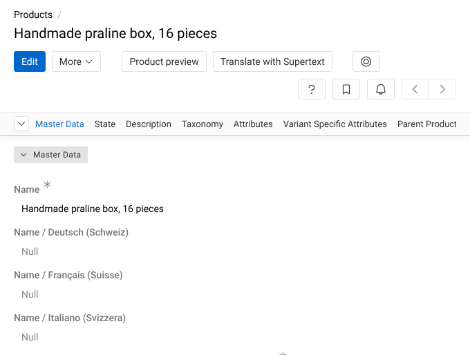
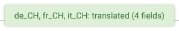
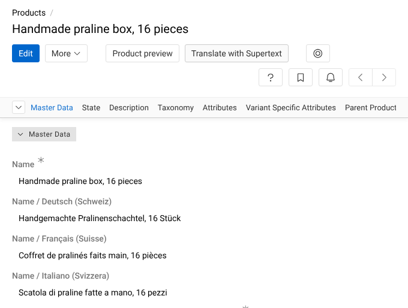
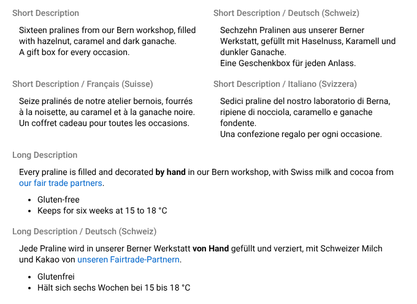
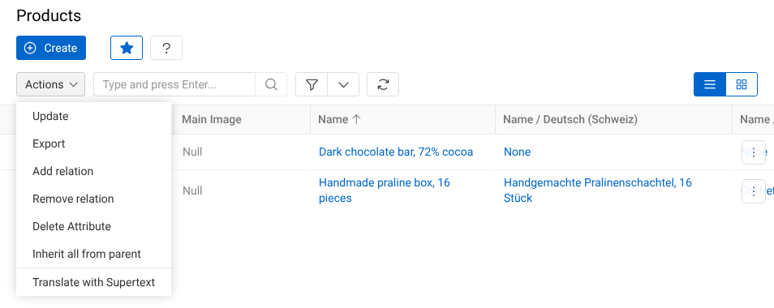
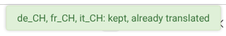

# User guide — Supertext Translation for AtroPIM

For editors. **Translate with Supertext** translates a product's texts (or another record's) from one language into your other languages with Supertext AI, and saves them in the record's language fields. Your administrator decides which languages and records it covers (see the [installation guide](INSTALLATION.md#the-action)).

The Supertext fields and messages follow your AtroCore interface language (English, German, French or Italian, from the locale in your profile). The messages below are the English texts.

## Translate a product

1. Open the product. The texts in the other languages are still empty (*Null*):

   

2. Click **Translate with Supertext** (next to *Edit*, or in the *More* menu, depending on your setup).
3. After a few seconds AtroPIM shows what was translated, per language:

   

4. The page reloads with the translations:

   

Long texts keep their formatting, and attribute values are translated too:

## Translate several products

In the product list, select the products, open **Actions** and choose **Translate with Supertext**. Each product is translated on its own; the message says how many were translated. Large selections run in the background, and AtroPIM notifies you when they are done.

## Review the translation

The translation is saved right away, like a change you make yourself: it appears in the product's history (*Activities*), and AtroPIM's rules for the fields apply. Read it in each language, correct it with **Edit** where needed, and change the product's status as you usually do. Supertext AI is good, but it doesn't know your product range: check names, measurements and terms that must stay the same.

## Translate again

Translating again **keeps** every field that already has text in a language, so your corrections are never lost:

To translate a changed text again, empty that field in the target language (**Edit**, delete the text, save) and click **Translate with Supertext**. If your administrator has set up an action that overwrites existing translations, it replaces all target texts at once; use it with care.

## Export for translation and import the translated file

Instead of translating with Supertext AI right away, you can export a record's texts as a file, have it translated elsewhere, and import the translated file. Your administrator sets up the two buttons (see the [installation guide](INSTALLATION.md#export-for-translation-and-import-translation)).

1. Open the product and click **Export for translation**. AtroPIM downloads a file (the message names it, e.g. `atropim-product-<id>-de_CH.xlf`). Allow pop-ups for AtroPIM if your browser blocks the download tab. The file contains the same texts *Translate with Supertext* would send: the multilingual text fields that are filled in the source language and still empty in the target language (all of them if the action overwrites).
   - **XLIFF 1.2 (for translation tools)** is the better choice for translators and translation tools (Trados, memoQ, Phrase, …): formatting appears as protected tags, and one file can hold several target languages.
   - **HTML (one language per file)** can be uploaded to Supertext's web app or translated by anyone who works with HTML. Translators must leave the file's head (the `supertext:` lines) and the `data-st-id` attributes alone. An HTML file can't mark a text as untranslated: imported unchanged, it writes the source text into the target language.
2. Send the file to your translator, open it in your translation tool, or upload it at supertext.com.
3. When the translated file is back, click **Import translation** (on a product or in the product list). A page opens in a new tab: choose the file under **Translated file (XLIFF or HTML)** and click **Import translation**. Options:
   - **Also import texts whose source changed since the export** (off): a text that was edited in the source language after the export is skipped unless you tick this.
   - **Overwrite existing translations** (off): a field that got text in the target language since the export is kept unless you tick this.
4. The page shows a summary per record and language (e.g. *Product &lt;id&gt;, de_CH*):

| Line | Meaning |
| --- | --- |
| Imported: 3 | Saved in the target language, like a translation with Supertext (in the record's history, with AtroPIM's field rules). |
| Skipped, source changed since the export: 1 | The source text was edited after the export. Export again, or import with *Also import texts whose source changed since the export*. |
| Not translated in the file: 1 | The file has no translation for this text. |
| Formatting changed, not imported: 1 | The translation breaks or adds formatting (tags) the source doesn't have. Fix it in the file and import again. |
| Not in the file: 1 | The text isn't in the file, e.g. a field filled after the export. |
| Kept, already translated in AtroPIM: 1 | The field got a translation since the export; tick *Overwrite existing translations* to replace it. |

Errors instead of a summary: *This file isn't a valid XLIFF or HTML translation file.*, *This file wasn't exported by the Supertext module, or its header was removed.*, *The file is too large (at most 10 MB).*, *This file belongs to another system (…)* (exported by another Supertext plugin), *The record this file was exported from no longer exists.*, *AtroPIM has no language …*, *You may not edit this record.* Nothing is saved for a record with an error. *Nothing to translate.* when exporting means every field is empty in the source language or already translated.

## What is translated

| Translated | Not translated |
| --- | --- |
| Multilingual text fields: single-line text, multi-line text, Markdown and rich text (HTML) | Fields that aren't multilingual |
| Multilingual attribute values of these types | Numbers, dates, lists of options, booleans, files, relations |
| Rich text with its formatting: bold and italic text, links, lists, headings | Read-only fields |
| | Fields that are empty in the source language |

- Each text is translated as a whole, so sentences stay intact.
- A target language that already has text in a field is kept unless the action overwrites.
- Formal or informal address (*Sie*/*du*, *vous*/*tu*, *Lei*/*tu*) is used where the action asks for it and Supertext offers it; English, for example, has none, and the message says so.
- Single-line fields have a maximum length; a translation that is longer is not saved (the message names the field) and the other fields are.

## Messages

| Message | Meaning |
| --- | --- |
| `de_CH, fr_CH: translated (4 fields)` | Done: four fields were translated into German and French. |
| `it_CH: kept, already translated` | Every field already had Italian text: nothing changed. |
| `nothing to translate` | The source language has no text in the translatable fields. |
| `Supertext translated 3 of 4 records.` | Several products: one failed; the action's **Executions** panel (administrators) shows why. |
| `The translation is longer than the field allows: Name` | The Name translation was too long and not saved; the other fields were. |
| `No Supertext API key is configured …` / `Authentication failed …` | The Supertext connection isn't set up yet. Ask your administrator. |
| `The language fr_BE has no Supertext language yet. Ask your administrator to choose one …` | AtroPIM doesn't know which Supertext language this is, and there is no obvious one: your administrator chooses it on the Supertext connection (*Supertext language for … (fr_BE)*). Nothing was sent to Supertext. Ask your administrator. |
| `Supertext does not support this language pair (en → …)` | Supertext can't translate into this language, or the connection's Supertext language for it is wrong. Tell your administrator. |
| `… translated (4 fields). Supertext offers no formal or informal tone for en_US: translated with the default tone.` | Done; the action asks for a formal or informal form of address, but Supertext offers none for this language (e.g. English), so it was translated with the default tone. |
| `Supertext offers no formal or informal tone for this language …` | Supertext refused the form of address the action asks for. Ask your administrator to set the action's form of address to *Default*. |
| `Too many requests to Supertext` / `Timed out …` | Supertext was busy or the text was long. Try again in a moment. |
| `… has no multilingual text fields` | This kind of record has nothing to translate. Ask your administrator. |
| `Translate with Supertext is finished. To view the result, click here` | AtroPIM's notification when the action has run; the link opens the run's details. |
